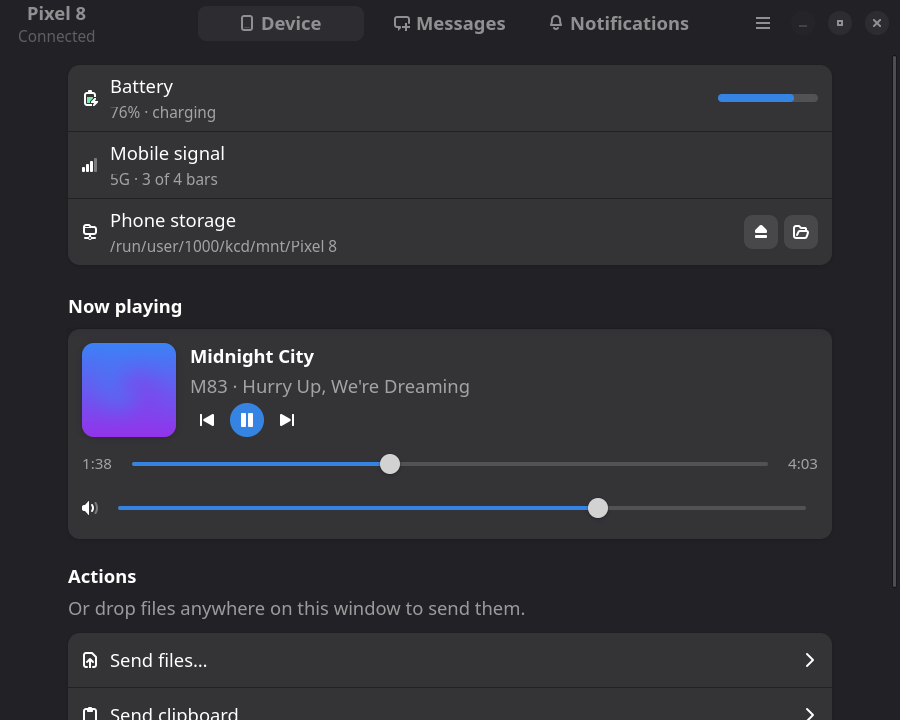
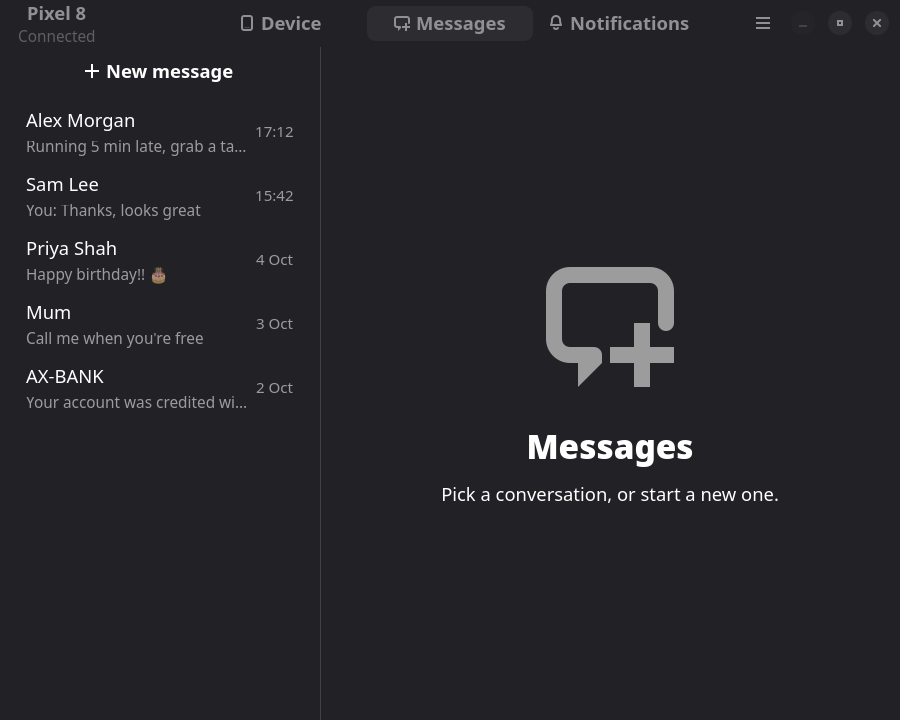
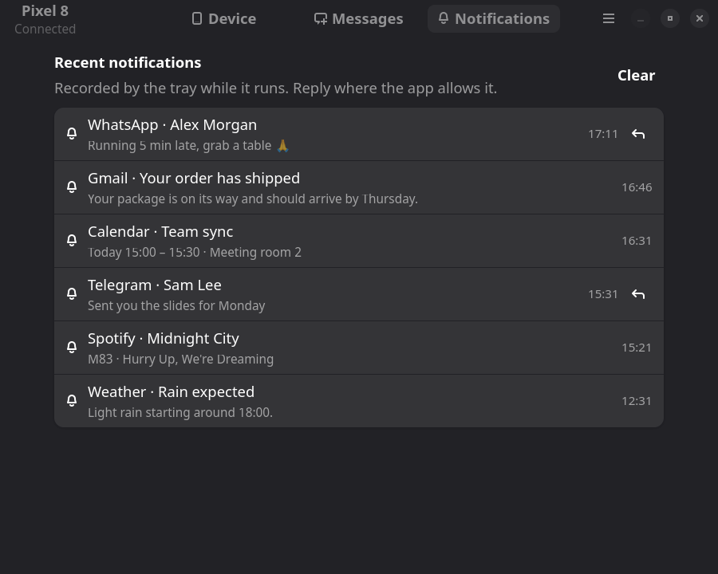

# kcd-indicator

A system tray indicator and companion window for [kcd](https://github.com/bethropolis/kcd), the headless KDE Connect daemon, inspired by `kdeconnect-indicator`.

The tray icon shows your phone's battery and connection state. Its menu covers the everyday actions: browse files, send the clipboard or a file, ring, ping, media controls and pairing. Left-click opens a GTK 4 / libadwaita window with the device overview, SMS conversations and recent notifications with inline replies.

## Screenshots

| Device | Messages | Notifications |
|---|---|---|
|  |  |  |

## Requirements

- [kcd](https://github.com/bethropolis/kcd) running as a user service, with your phone paired
- A StatusNotifierItem tray (Waybar, KDE Plasma, GNOME with the AppIndicator extension, …)
- GTK 4.14+ and libadwaita 1.6+
- Optional: `zenity` (file picker for *Send file* in the tray menu), `notify-send` (pairing alerts)

## Install

Build dependencies, then build and install with Cargo (Rust 1.85+):

```sh
# Arch
sudo pacman -S --needed rust gtk4 libadwaita
# Debian / Ubuntu
sudo apt install cargo libgtk-4-dev libadwaita-1-dev

git clone https://github.com/Rishabh672003/kcd-indicator
cd kcd-indicator
cargo install --path .
```

This installs `kcd-indicator` to `~/.cargo/bin`. Run it, or start it on login:

```sh
cp kcd-indicator.desktop ~/.config/autostart/
```

The window can also be opened directly: `kcd-indicator --window [device|messages|notifications]`. Use `--debug` to log IPC traffic.

On tiling compositors you may want a window rule to float it; its app id is `io.github.kcd.Indicator`.

## License

[GPL-3.0-or-later](LICENSE)
